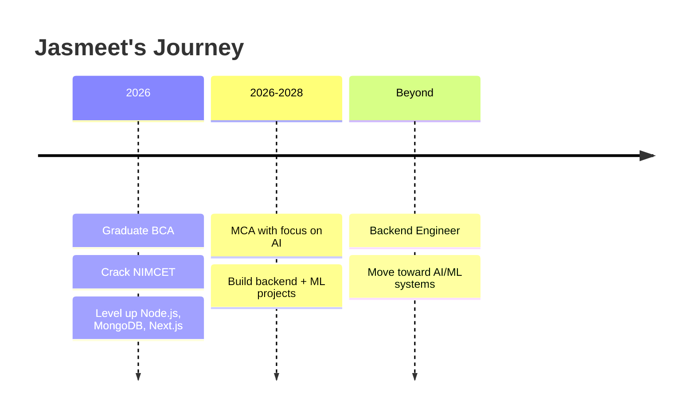

<!-- ===================== HEADER ===================== -->
<div align="center">


<a href="https://git.io/typing-svg">
  
</a>

<br/>


<br/><br/>

[](https://www.linkedin.com/in/jasmeet-singh-7a6387239/)
[](https://twitter.com/JasmeetSingh_17)
[](https://github.com/jasmeeeetsingh17)

</div>

---

## 👨‍💻 About Me

```js
const jasmeet = {
  role: "Aspiring Backend Developer",
  education: "BCA @ GGSIPU (MERI College) — Class of 2026",
  nextStep: "MCA via NIMCET, with a focus on AI",
  currentFocus: ["Node.js & Express APIs", "MongoDB", "Next.js", "System Design basics"],
  longTermGoal: "Backend → AI/ML engineering",
  funFact: "I debug with console.log() and I'm not ashamed!",
  lookingFor: ["Internships", "Open-source collabs", "Backend projects to learn from"]
};
```

- 🔭 Building backend systems and REST APIs
- 🌱 Learning **MongoDB**, **Next.js**, and the foundations of **AI/ML**
- 🎓 Preparing for **MCA** after graduation
- 💬 Ask me about backend development, databases, and web projects
- ⚡ I enjoy optimizing code and understanding *why* things work

---

## 🛠️ Tech Stack

<div align="center">

### Languages


### Backend & Frameworks


### Databases & Tools


</div>

<details>
<summary><b>📚 Skill breakdown (click to expand)</b></summary>
<br/>

| Area | Technologies |
|------|--------------|
| **Languages** | C, C++, Java, JavaScript, Python, PHP |
| **Backend** | Node.js, Express.js, REST APIs, Microservices (learning) |
| **Frontend** | HTML, CSS, React, Next.js, Bootstrap, Tailwind CSS |
| **Databases** | MongoDB, MySQL |
| **Tools** | Git, GitHub, VS Code, Postman |
| **Exploring** | AI/ML, IoT, Geo-data analysis |

</details>

---

## 🚀 Featured Projects

<table>
  <tr>
    <td width="50%" valign="top">

### 🍔 QuickBite
Online food ordering system with a complete ordering flow.


[🔗 Repository](https://github.com/jasmeeeetsingh17?tab=repositories)

    </td>
    <td width="50%" valign="top">

### 🤖 College Admission Agent
AI-powered chatbot that guides students through college admission queries.


[🔗 Repository](https://github.com/jasmeeeetsingh17?tab=repositories)

    </td>
  </tr>
  <tr>
    <td width="50%" valign="top">

### 🌳 ReLeaf
Tree-planting subscription landing page, deployed live.


[🌐 Live Demo](https://releaf-taupe.vercel.app)

    </td>
    <td width="50%" valign="top">

### ✅ Next.js To-Do App
Task manager with continuous UI/UX and styling iteration.


[🔗 Repository](https://github.com/jasmeeeetsingh17?tab=repositories)

    </td>
  </tr>
  <tr>
    <td colspan="2" valign="top">

### 🏦 BlackRock Website Replica
Pixel-focused recreation of a corporate website to practice responsive, production-style frontend work.


[🔗 Repository](https://github.com/jasmeeeetsingh17?tab=repositories)

    </td>
  </tr>
</table>

> 💡 Replace each **Repository** link with the exact repo URL (`https://github.com/jasmeeeetsingh17/<repo-name>`).

---

## 🎓 Certifications

| Certification | Issuer |
|---------------|--------|
| 🛰️ AI/ML for Geo Data Analysis | **ISRO** |
| 🌐 IoT Edge Computing | **Infosys Springboard** |
| 🔧 Git & GitHub | **Udemy** |

---

## 🧭 Roadmap



---

## 📊 GitHub Stats

<div align="center">


</div>

### 📈 Contribution Graph

<div align="center">
  
</div>

---

## ✍️ Quote of the Day

<div align="center">
  
</div>

---

## 🤝 Let's Connect

<div align="center">

Open to **internships**, **collaborations**, and **learning opportunities**.
Feel free to reach out on [LinkedIn](https://www.linkedin.com/in/jasmeet-singh-7a6387239/) or [Twitter/X](https://twitter.com/JasmeetSingh_17).

⭐ *If you like my work, consider starring a repository!* ⭐

</div>


